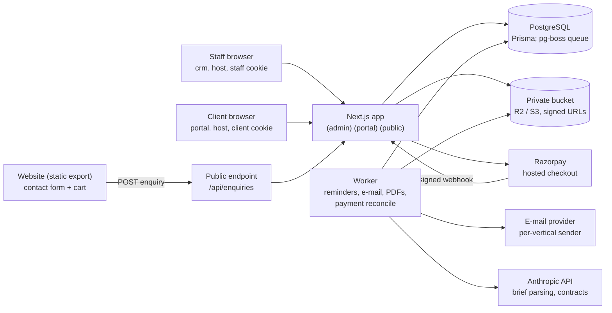
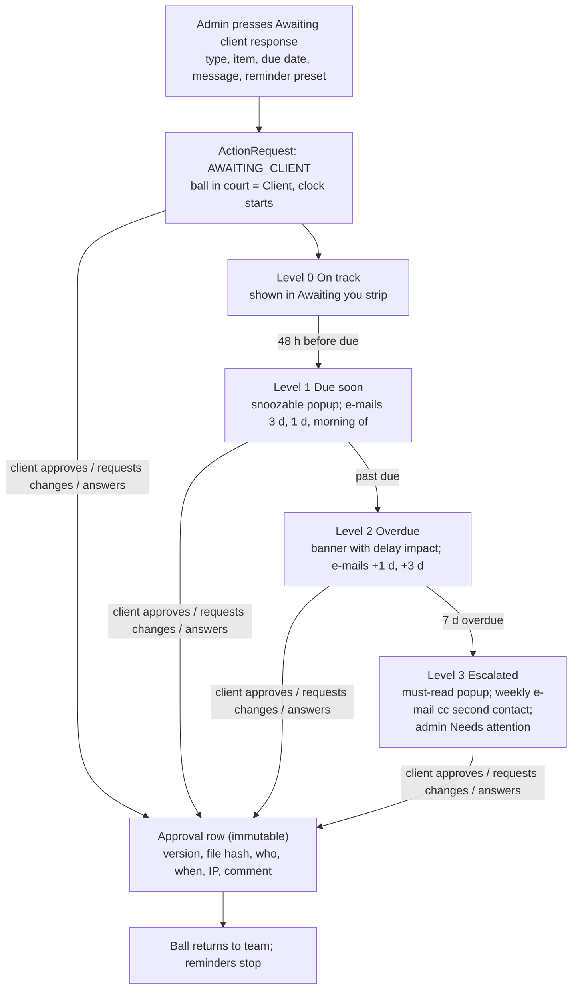

# Kreatif CRM: architecture, info checklist and Claude Code prompt

Oct 25, 2026 · @roo · checked against both zips and the website on 2026-10-25

Build one new server-side CRM app with an admin area and vertical-branded client portals, and reuse the 206-service catalogue, pricing, PDF and safety code from your two zips, because neither zip has login, a client portal or payments.

## What is inside your two zips

Both are acquisition tools: they find prospects, audit them and draft outreach. Each GitHub download holds only a README and a second zip. Both inner zips are extracted (read-only reference) at:

- `~/Developer/kreatif-crm-reference/kreatif-ngo-platform/kreatif-ngo-platform` (from ashraya-crm)
- `~/Developer/kreatif-crm-reference/aurelius-radar/aurelius-radar` (from aurelius-crm)

Every file named in the table below was checked to exist there.

|  | NGO platform (from ashraya-crm) | Aurelius Radar (from aurelius-crm) |
| --- | --- | --- |
| Stack | Next 16.4.2, Prisma 6.19.3, Tailwind 4, zod, vitest, react-pdf, exceljs | Next 15, Prisma 6, Tailwind 3, pdfkit, exceljs, Leaflet |
| What it does | NGO research and audit, 276-NGO Hyderabad directory, outreach CRM, map, PDF and Excel exports | Prospect audit, social intent radar, international directory, pipeline kanban, offer planner |
| Reuse | 206-service catalogue seed (11 practice areas); Silver, Gold and Platinum packages with 40 add-ons and the quote-builder formulas; draft-to-approved pricing policy; `assertClientSafe` and the internal versus client-facing export split; outreach tone lint; untrusted-text sanitiser; CSV-injection guard; import with preview; security headers and same-origin check in `src/proxy.ts` | `data/pricing.json` and `lib/pricing.ts` (multi-currency, market multipliers); `lib/leads/quote.ts` and `plan.ts` (tier and service recommendation); pipeline stages (`PIPELINE_STAGES` in `lib/types.ts`); SSRF-safe fetcher `lib/audit/safe-fetch.ts`; CSS-variable theme pattern |
| Leave behind | One shared Basic-auth password, SQLite default, its UI components | Its UI (Tailwind 3), SQLite default |

What neither has: user accounts, roles, a client portal, e-mail sending, documents, payments. All of that is new. Both READMEs warn the apps must not be public without a login.

Decision: do not merge the two apps. Build the CRM fresh and port their logic as an Acquisition module late in the build.

Two things to confirm. The NGO workbook prices retainers at 15,000, 25,000 and 40,000 rupees a month excluding GST, while the Radar defaults are 25,000, 50,000 and 1,00,000; treat them as separate price books per vertical and tell me which are current. The catalogue seed has 206 services (DM 29, PR 17, PRO 14, SEO 20, BR 25, AD 24, AN 15, LG 19, FM 24, TP 12, AV 7). Checked on 2026-10-25 against the website's `content/aurelius-services.ts`: all 206 codes and names match, no differences.

## Architecture at a glance



Staff and clients enter through separate hosts and cookies, and the website posts enquiries to the public endpoint. The app holds the logic; the worker sends reminders and e-mails, renders PDFs and checks payments from a queue stored in Postgres.

## Stack and hosting

The CRM must be its own server app, because the website is a static export (`output: 'export'`) and cannot hold logins, a database or payments. It lives in a new repo, `kreatif-crm`, and the website links to it.

| Layer | Choice | Why |
| --- | --- | --- |
| App | One Next.js 16 app, App Router, TypeScript, route groups `(admin)`, `(portal)`, `(public)` | Same stack as the website and the NGO platform; one codebase, hosts decide which area you see |
| Database | PostgreSQL with Prisma 6.x | Both zips use Prisma 6 on SQLite; Postgres from day one avoids a migration later (the NGO repo ships `scripts/use-postgres.mjs`) |
| Auth | Auth.js or Better Auth, whichever is current when you start | E-mail and password plus magic link, mandatory TOTP 2FA for staff, argon2id hashing, rate limits, session revocation |
| Background jobs | pg-boss worker (Postgres-backed queue) | Reminders, e-mails, PDF rendering and contract extraction need reliable scheduling without adding Redis |
| File storage | Private S3-compatible bucket (Cloudflare R2 or S3) | Signed short-lived URLs, no public files, virus scan on upload |
| E-mail | Resend, Postmark or SES, with SPF, DKIM and DMARC per vertical sending domain | Branded sender per vertical; bounce and complaint webhooks |
| Documents | HTML templates rendered to PDF by headless Chromium (Playwright); `pdf-lib` to stamp uploaded PDFs; `sharp` for images | Handles Hindi and Telugu fonts; the NGO platform's react-pdf setup renders Latin text only (its README says so) |
| Payments | Razorpay first for INR, behind a provider interface so Stripe or another gateway can be added | Hosted checkout only, so no card data touches your server |
| AI | Anthropic API; model ID in an env variable | Brief parsing, contract extraction, suggestion wording; every output is validated and confirmed by a person |
| UI | Tailwind 4, base-ui primitives, Motion for UI transitions, tokens copied from the website's `styles/design` | Keeps the Aurelius look; copy first, extract a shared package later |
| Hosting | A long-running Node host (Railway, Fly or Render) with managed Postgres, web process plus worker | Vercel works only if jobs move to Inngest or Trigger.dev; the NGO README notes a 300-second limit on long runs |
| Tests | vitest for pure logic, Playwright for flows and cross-client access, an injectable clock | Reminder and delay logic must be testable by moving time |

Skip for now: microservices, Redis, row-level security. Add them only if the app outgrows this.

## Verticals and branded portals

One deployment serves every vertical. A `Vertical` row holds its name, status, logos (light and dark), theme tokens (light and dark), fonts, e-mail sender, document letterhead, legal entity for invoices and portal domain. All five verticals are seeded; Aurelius and Asraya are active, the other three are planned. Adding a vertical later means adding a row, tokens and a logo, with no code change.

When you create a client you choose the vertical. From then on the portal skin, logo, e-mail templates and document letterhead follow it. The server reads the skin from the client's account, never from the URL, so a client cannot open another brand's portal. Projects also carry a vertical, so an account that later buys from two verticals (an NGO buying Aurelius services, for example) can get a switcher without changing the schema.

Staff access is per vertical: an Asraya manager does not see Aurelius finances unless you grant it.

| Vertical | Design language | Where Claude Code finds it |
| --- | --- | --- |
| Aurelius (active) | Maroon and gold neumorphic, glass for overlays; Anton, Cormorant Garamond and Manrope | Website `styles/design/aurelius-theme.css` and `lib/design/aurelius.ts`; logo is the horse emblem, still unconfirmed |
| Asraya (active) | Paper, slate, oxblood, kraft and blue grounds, Anton headlines, red emphasis | Website `.asraya` styles in `app/globals.css` and `content/asraya.ts`; no logo supplied yet |
| Kreatif Atelier (admin skin) | Ink and porcelain, KA monogram and script wordmark | Website brand marks (`ka-monogram.webp`, `ka-wordmark.webp`) |
| Valora, Golden Guardian Productions, Rudra Yugen (planned) | Not started | Valora's swan mark exists on the website; others need logos and palettes |

Every vertical ships both a light and a dark token set, written as CSS variables under `[data-vertical][data-mode]`.

## Roles, access and keeping client data safe

| Role | Sees | Can do |
| --- | --- | --- |
| Owner | Everything, all verticals | Settings, roles, finance setup, anything below |
| Admin | All verticals, or the ones assigned | Clients, projects, templates, assets, portal control |
| Manager | Their vertical's clients and projects | Approve estimates, send requests to clients, issue invoices if allowed |
| Team member | Assigned projects only | Upload deliverables, comment; no finance |
| Accountant | Invoices, payments, GST reports | Read-only elsewhere |
| Client owner | Their own account | Approve, sign, pay, edit company details |
| Client approver | Their own projects | Approve or reject deliverables; no billing |
| Client viewer | Their own projects | Read-only progress |

Rules that keep it safe:

- **Two hosts, two cookies.** Staff use one host (for example `crm.`), clients another (`portal.`); the names are placeholders until you pick domains.
- **Credentials.** You create the account and choose the vertical. The default sends an invite link where the client sets their own password. The option you asked for, setting an id and password yourself, creates a one-time temporary password shown once, with a forced change at first login. Passwords are never stored in readable form.
- **No leakage by design.** Every client-facing read goes through one data-access layer scoped by account and vertical, and Prisma models never reach the browser; only whitelisted `toClientView` mappers do. This is the rule the NGO platform already follows (`assertClientSafe`, internal versus NGO-facing exports). Internal notes, costs, hours and margins have no path into a client view, and a test fails if a forbidden field shows up in a client response.
- **Access tests.** Playwright tests try every route as the wrong client and the wrong vertical; the answer is 404, not 403.
- **Staff 2FA is mandatory**, client 2FA optional; login rate limits, lockout, session list and revoke.
- **Audit log, append only**: logins, approvals, downloads, document views, permission changes, impersonation. "Preview as client" is read-only, shows a banner and is logged.
- **Uploads**: type and size limits, virus scan, private storage, signed URLs.
- **Untrusted text.** Contract PDFs and client-typed fields are data, never instructions (port `lib/ai/untrusted.ts`). Client values are escaped before entering any HTML template, and Chromium renders with scripts and outside network requests blocked.
- **Request hygiene.** Same-origin check on every state-changing request and security headers (port `src/proxy.ts`, minus its Basic-auth gate).
- **Privacy.** Consent log plus data export and delete on request. Ask your lawyer which of India's DPDP Act, GDPR and Canada's PIPEDA apply to your clients; I am not a lawyer.

## Data model

Claude Code writes the Prisma schema phase by phase; this is the shape it aims for. The catalogue, package, pricing-policy, note and audit-log models can be lifted from the NGO platform's `prisma/schema.prisma`.

| Group | Entities |
| --- | --- |
| Identity and tenancy | Vertical, User, Session, StaffRole (per vertical), ClientAccount, ClientContact (approver flag, timezone, language), Invite |
| Catalogue and pricing | PracticeArea, Service (206), Package, AddOn, FeatureOption (brief options with effort modifiers), PricingPolicy (draft, then approved), PriceBook per vertical and currency |
| Sales | Lead, Enquiry (from the website cart and contact form), Quote, QuoteLine, PipelineStage |
| Projects | ProjectTemplate, Project (vertical, status, ball in court), BriefItem, Phase, Milestone, Deliverable, DeliverableVersion, Comment (pinned on a file), ChangeRequest, TimelineSnapshot (baseline and projections) |
| Actions and approvals | ActionRequest (type, target, due date, SLA days, status, escalation level), Approval (immutable decision record), ReminderRule, ScheduledNotification, NotificationLog, EmailLog |
| Documents | ClientMasterRecord with per-field verification, DocumentTemplate (versions, merge-field schema), GeneratedDocument (hash, status), SignatureEvent |
| Assets | Asset, AssetVersion, AssetLink (Drive), ShareGrant, DownloadLog, WatermarkProfile |
| Money | LegalEntity, Invoice, InvoiceLine, CreditNote, Payment, PaymentEvent (raw webhook), Receipt, NumberSequence |
| Intelligence | Contract, ContractTerm (value, source page, confidence, verified flag), SuggestionRule, Suggestion (shown, clicked, accepted), EstimationRule, ActualsLog, TimeEntry (optional) |
| Feedback | FeedbackRequest, FeedbackResponse (CSAT, NPS, testimonial consent) |
| System | AuditLog (append only), Setting, FeatureFlag, Attachment |

Four rules apply to all of it. Money is stored as whole minor units plus a currency, never as decimals. Every business row carries a `verticalId`. Approval and AuditLog rows are never updated or deleted. Client-facing data leaves the server only through view mappers.

## Client onboarding to kickoff

1. **Create the client.** You choose the vertical and enter the basics: name, contact, timezone, language.
2. **Write the brief.** Pick services from the 206-service catalogue and tick the options that change effort, such as scroll-type animation, multi-language (and how many languages), CRM included, number of pages, integrations and whether content is ready.
3. **Get the estimate.** The estimator returns a timeline range, phases and milestones, plus a price only if an approved pricing policy exists. You edit it, then press Send estimate.
4. **Client approves or redoes.** The client receives an invite, logs into the branded portal and sees the estimate as a popup: Approve and move ahead, or Request changes with a comment. Each revision is kept as a version.
5. **Client details, then verification.** The client fills Your details: legal name, address, tax ids, signatory name and designation, billing e-mail. You open the verification screen, check each field and mark it verified. A verified record locks; any later change needs re-verification.
6. **Documents.** You generate the MOU and quotation from the universal templates. The portal shows them for review and acceptance.
7. **Advance payment.** The advance invoice is issued and the client pays through the gateway.
8. **Kickoff.** The baseline timeline is frozen for later delivery analysis, the first milestone appears in the portal and the project goes live.

## Approvals, awaiting-client button and delay warnings

One building block, the **ActionRequest**, covers everything that waits on a client: approve the estimate, approve a deliverable, answer a question, give feedback, sign a document, pay an invoice. Each one has a due date, an SLA, a reminder schedule and an escalation level.

**The Awaiting client response button.** It sits in the header of every project and deliverable. One click opens a drawer: pick the type and the item, set the due date (it defaults to the SLA), write a message and choose a reminder preset. This sets the ball in court to Client, starts the clock and notifies them. When the client responds, or you press Client responded, the ball returns to the team. Waiting time is recorded separately for each side, so delivery analysis can show how many days a project waited on the client and how many on you.



Read it top to bottom: the request waits in Awaiting client, reminders run on the ladder below, and the first reply ends the cycle with an immutable record.

**Warning ladder.** All timings below are defaults you can edit per vertical and per request type.

| Level | When | What the client sees | E-mail |
| --- | --- | --- | --- |
| 0 On track | More than 48 hours before the due date | The item in an Awaiting you strip | The original request |
| 1 Due soon | Within 48 hours | A gentle popup they can snooze | Reminders 3 days before, 1 day before and the morning of the due date |
| 2 Overdue | Past the due date | A banner: waiting on your approval, and a delay can move the launch from one date to another | Pending, please update soon, at 1 day and 3 days after |
| 3 Escalated | 7 or more days overdue | A popup on login that must be read before dismissing | Weekly, copied to a second contact; the admin gets a Needs attention alert |

**Rules for sending.** Reminders go out in the client's local time between 9:00 and 18:00 and skip weekends if you choose. They stop the moment the client responds and pause while a project is on hold or while the ball is in your court. Every e-mail is logged with delivery and bounce status and is checked by the tone lint ported from the NGO platform, so nothing reads as a threat.

**Delay impact.** The estimator reruns the schedule with the overdue wait included. The warning names a new launch date only when that item sits on the critical path; otherwise it says the delay may affect the schedule.

**Every decision is a permanent record.** An approval stores the deliverable version, a hash of the file, who decided, when, from which IP and the comment. It is never edited.

**Deemed approval** (auto-approve after N days of silence) is off by default. Turn it on only if your MOU says so.

## Timeline estimator

The estimator is plain, explainable arithmetic over rules you can edit. AI may turn a free-text brief into ticked options, but it never does the maths. The output is a range with its assumptions listed, never a single confident date.

**Inputs:** the chosen services (catalogue codes), option flags with quantities, a start date, team capacity and a working calendar with holidays.

**Method:** each service and option has a base effort in days, scaled by a quantity factor and a complexity factor. Each phase has a parallelism factor. Every approval gate adds the SLA wait on the high side, and a buffer percentage is applied on top.

```latex
T_{low} = \sum_{p} \frac{\sum_{i \in p} b_i \, q_i \, c_i}{k_p}
\qquad
T_{high} = T_{low}\,(1+\beta) + \sum_{p} w_p
```

Here b is base days, q the quantity factor, c the complexity factor, k the phase parallelism, w the assumed wait at each approval gate and β the buffer. The low case assumes every approval comes back the same day.

**Rules table.** Admins edit it in the CRM. The numbers are yours; I have not invented any. Claude Code seeds placeholders marked TODO, and the estimator shows needs rules instead of a range until they are filled in.

| Option in the brief | What it changes | Number you supply |
| --- | --- | --- |
| Scroll-type animation | Design and front-end days per section | Days per section, low and high |
| Multi-language | Content and QA days for each extra language | Days per language |
| CRM included | An extra build phase plus training | Days for the phase |
| Number of pages or screens | Days per page | Days per page by page type |
| Content ready or not | Adds or removes a content-collection phase | Days for the phase |

**Output:** a range such as 6 to 8 weeks, dates per phase and milestone, the assumptions in plain words, and price lines only from an approved pricing policy.

**Learning loop.** When projects close, the CRM compares estimate with actual per service code and shows the median and 80th-percentile actuals next to your rules. You accept or ignore each suggested change. Suggestions appear only after about five finished projects of that type, so early numbers stay your judgement. The NGO workbook makes the same point about its own hours: they are estimates until real time tracking replaces them.

## Service suggestions and change requests

**Suggestions start as rules you write, not as machine learning**, because on day one there is no purchase history. A rule reads: if the client took these services or practice areas, suggest these others, with a one-line reason the client sees. The NGO platform's `src/lib/research/match.ts` and the Radar's `lib/leads/plan.ts` already use this pattern, each recommendation carrying the signal that triggered it. After about 20 clients, add a clients-who-took-A-also-took-B signal beside the rule's reason.

- **Where they show.** A What could help next card in the portal, after a milestone is approved or a project closes. Each card has the service, the reason and an Ask about this button. The button creates an enquiry for the account manager and logs it; it adds nothing to a cart and shows no price.
- **Your control.** Suggestions stay hidden until you approve them, which is the default. You can hide any for one client, keep a never-suggest list per vertical, and no price appears unless an approved pricing policy exists (the NGO platform's rule).
- **Measurement.** Shown, clicked and converted are tracked per rule, so weak rules get edited or dropped.

**Change requests protect your scope.** A client asks for something outside the brief through Request a change. It becomes a ChangeRequest with an estimate of extra days and price. You review it, the client approves it, and the timeline baseline is updated with a note. Each deliverable type has a number of included revision rounds; asking for one more automatically opens a change request instead of silently extending the work.

## Documents: templates, verification, asset vault, watermarks

**Client master record.** One record per client holds every field a document needs: legal name, trade name, address, state and country, GSTIN or tax id, PAN, signatory name and designation, billing and notice e-mails, phone. The client fills it in the portal. Every field remembers who entered it and when.

**Verification screen.** Before you generate a document, this screen shows only the fields that document uses, each with its value, its source (client-entered or admin-edited) and a verified tick. An admin edit needs a reason. A verified record locks, and any later change flags every document already generated from the old value.

**Template maker.** Templates are versioned HTML with merge fields such as `{{client.legalName}}`, optional clauses and repeating blocks for invoice lines. The editor has a merge-field picker and a live preview with a sample or a real client. Publishing creates a new version, and each generated document remembers the version it used. Your existing MOU and bill are imported from Word as the starting point. Strict mode means a missing field blocks generation instead of printing a blank. Starting set: MOU, quotation, invoice, receipt, NDA, statement of work, plus any you add.

**Generation.** The vertical's legal entity supplies the letterhead. The footer carries a document id and a hash, and the file is marked DRAFT until accepted. Hindi and Telugu fonts are bundled.

**Acceptance.** The client reviews the document in the portal and accepts with a typed name; the system records the time, IP and document hash and adds a certificate page. Whether that is enough for your MOUs, or whether you need Aadhaar eSign or a signing provider, is a question for your lawyer. The code keeps a provider slot open.

**Asset vault (admin).** Folders by vertical (Shared, Aurelius, Asraya and so on) hold logos, visiting cards, letterheads, brand guidelines, company profiles, certificates, MOU templates and signature or stamp images. Each asset is an uploaded file or a Drive link with a title, vertical and visibility: internal, chosen clients or public. Versions are kept, sharing with a client is an expiring grant, and every download is logged.

**Watermarking.** PDFs are stamped with `pdf-lib` and images with `sharp`. Two modes: a company mark on every external copy, and a per-recipient stamp such as Prepared for the client and the date. Originals are never overwritten; the stamped copy is made per recipient. An optional preview-until-paid rule shows clients watermarked deliverables until the final invoice is paid, then unlocks clean files. A watermark deters and traces; it cannot stop a screenshot.

## Invoices and payments

- **Legal entity per vertical.** Each vertical issues invoices from a legal entity with its own name, address, GSTIN, PAN, bank details, logo and invoice-number format. If all verticals sit under one company, there is one entity and several letterheads.
- **Numbering.** A gapless sequence per entity and financial year, taken inside a database transaction. Numbers are never reused or deleted; corrections are credit notes.
- **GST and tax.** A pure, tested calculation module handles CGST plus SGST inside a state, IGST across states and zero-rated export of services to foreign clients, with an SAC code per service and tracking of tax the client deducts at source. Rates and rules come from settings, not code. Your CA should confirm them before launch.
- **Currencies.** An invoice is issued in the client's currency. The Radar's `data/pricing.json` and `lib/pricing.ts` give price books and market multipliers; the exchange rate on the invoice date is stored for reporting.
- **Milestone billing.** Each invoice can be tied to a milestone: advance, on approval of a stage, on delivery. The percentages are yours. Retainer tiers (Silver, Gold, Platinum) generate recurring invoices and renewal reminders.
- **Gateway.** A provider interface with create order, verify webhook, fetch payment and refund; Razorpay first. Checkout is hosted, so card data never touches your server. Only a signed webhook marks an invoice paid, never the browser's success page. The webhook handler is idempotent, raw events are stored, and a daily job reconciles the gateway with your invoices. A refund creates a credit note.
- **Receipts and reminders.** A PDF receipt is e-mailed from the vertical's sender. Overdue invoices use the same reminder engine as approvals.
- **Accountant view.** Receivables ageing, GST summary, CSV and Excel export with the CSV-injection guard from the NGO platform's `lib/export/crm.ts`.

## Contract intelligence

The goal is that renewals, payment dates, revision limits and obligations never live only inside a PDF.

1. **Source.** Documents generated from your templates already have structured data. Uploaded signed or third-party PDFs go through text extraction, with OCR for scans.
2. **Extraction.** Claude fills a fixed schema: parties, effective date, term, renewal and notice period, fees and payment schedule, scope, revision rounds, IP ownership, confidentiality, termination, governing law, deliverables. Every term carries its source page, the quoted text and a confidence level.
3. **Verify screen.** The PDF sits on the left and the extracted terms on the right. You confirm or correct each one. Only verified terms drive anything.
4. **What verified terms drive.** Renewal and expiry alerts, suggested payment schedules, default revision limits and SLAs, and an obligations checklist.
5. **Clause check.** A contract is compared with your standard MOU, and missing or changed clauses are flagged.

Safety: contract text is untrusted input. Output must pass a schema check, instructions hidden in a PDF are ignored, and nothing is applied without your confirmation. This is an aid for you, not legal advice.

## Feedback and project delivery analysis

**Feedback.** After each approved milestone a short popup asks for 1 to 5 stars and an optional comment. At project end the client gives a 0 to 10 recommend score, what went well, what to improve, and a tick box that allows their words to be used as a testimonial; the consent is stored. A score of 3 or lower alerts the manager at once, and no automatic reply is sent. Only one feedback request is open at a time.

**Delivery analysis** is an admin dashboard shown by project, service, vertical and month.

| Metric | How it is computed | What it tells you |
| --- | --- | --- |
| Schedule variance | Actual end date against the frozen baseline | Whether estimates hold |
| On-time milestones | Share finished by their baseline date | Team reliability |
| Client wait versus team time | Days the ball sat in each court | Fair attribution of delay |
| Approval latency | Median time from sent to decision, per client and deliverable type | Who is slow |
| Revision rounds | Rounds per deliverable type and service | Scope and quality signals |
| Change requests | Count and value per project | Scope creep |
| Estimate accuracy | Estimated against actual days per service code | Feeds the estimator's learning loop |
| Satisfaction | Star and recommend scores per vertical and service | Quality over time |
| Margin (internal only) | Revenue minus tracked hours times cost rate | Needs optional time tracking; never in a client view |

Time tracking is off by default; only the margin metric depends on it.

## Web scraper section, source tags and activity log

The scraper lives in its own Acquisition section of the admin area, but everything it finds is saved into the main CRM as prospects, so there is one list of people and companies, not two.

- **Source tag on everything.** Each record shows where it came from: Web scrape (with the job and URL), Uploaded by an admin, or Added by an admin, plus the date and time. The tag is stored per record and per field, so you can see which value came from which source.
- **Contacted by.** When an admin marks a prospect Contacted or Interested, the row is flagged Contacted by that admin, with the date and channel. If another admin tries to log a contact on the same prospect, they get a warning first.
- **Activity log window.** A separate window, opened from any prospect or from the Acquisition home, lists every change with date, time, admin, what changed, the old value and the new value. It can be filtered and exported, and entries can never be edited or deleted.
- **Safe re-scrapes.** A new scrape never overwrites something an admin typed; it suggests the change for review. Duplicates are caught by domain, phone or e-mail and merged on a screen that shows both sources.

## Portal screens and the popup system

| Area | Screens |
| --- | --- |
| Client portal | Dashboard (Awaiting you strip, progress, next milestone, projected date); Project timeline; Deliverable detail (preview, versions, approve or request changes, pinned comments); Documents (MOU, quotes, invoices, with sign and pay); Messages; Shared assets; What could help next; Feedback; Your details; Notifications |
| Admin | Dashboard (awaiting-client queue, projects at risk, receivables, pipeline); Leads and pipeline; Clients with tabs for Overview, Projects, Documents, Billing, Portal settings and Activity; Projects board; Deliverables queue; Templates; Asset vault; Invoices and payments; Catalogue and estimation rules; Suggestion rules; Analytics; Verticals and branding; Team and roles; Settings (SLAs, reminders, e-mail templates); Audit log |

**Easy editing.** On any client's portal view an Edit portal switch lets you change the welcome note, show, hide and reorder modules, edit timeline items, upload deliverables and change statuses in place. Changes autosave with an Undo toast, and Preview as client shows exactly what they see.

**Popups** are driven by ActionRequests, so the same item also appears in the Awaiting you strip. Admins can also compose their own (last row): it is an ActionRequest of type CUSTOM with a small form schema, so it gets the same reminders, warnings and audit trail.

| Popup | Trigger | Client choices | Blocking |
| --- | --- | --- | --- |
| Approve estimate | Estimate sent | Approve and move ahead, or Request changes with a required comment | Only when overdue |
| Approve deliverable | A version is sent | Approve, or Request changes with a comment and pins on the file | Only when overdue |
| Information request | You ask for something | A short form or file upload | Only when overdue |
| Sign document | MOU or quotation ready | Review, then accept with a typed name | Only when overdue |
| Pay invoice | Invoice due | Pay now or download | Only when overdue |
| Milestone feedback | Milestone approved | Stars and a comment | Never |
| Suggestion | Milestone or project close | Ask about this, or Not now | Never |
| Delay warning | Warning levels 2 and 3 | Shows the impact; Respond now or Message us | Level 3 must be read |
| Admin-composed popup | An admin writes one from the client's page (Portal settings, New popup): an announcement, a question, a feedback form or an approval of any file, for one client or all clients of a vertical, with an optional due date | Whatever the admin chose: Acknowledge, Approve or Request changes, a short answer, stars | Only if the admin marks it required |

Rules: one popup at a time, in the order sign, approve, pay, information, feedback, suggestion. Snooze up to a day when not overdue, with frequency caps. Popups trap focus, work by keyboard, respect reduced motion and become a bottom sheet on phones.

## Design language, light and dark mode, motion

- **Portal and admin differ in density, not in identity.** Clients get the full vertical brand. The admin uses the same tokens but calmer and denser, because neumorphism's soft shadows lose contrast in tables and forms. Cards, KPI tiles and buttons are neumorphic; tables, inputs and filters are flat or inset; glass is only for overlays such as popups, drawers and the scrolled navigation bar.
- **Reuse from the website.** Copy `styles/design/tokens.css`, `materials.css`, `aurelius-theme.css`, `lib/design/aurelius.ts` and the primitives in `components/design` (NeuButton, Card, Field, Toggle, Tabs, Chip, Accordion, Badge, Tooltip). Colours come only from tokens, and the website's `scripts/palette-audit.mjs` idea is ported so a hardcoded colour fails the build.
- **Light and dark for every vertical.** Each vertical has both token sets. The default follows the system, a toggle saves the choice on the user, and a cookie lets the server render the right mode with no flash. Neumorphic shadows are re-tinted for dark. Text, gold text and focus rings must pass WCAG AA in both modes.
- **Motion.** Motion handles UI transitions: entrances 150 to 250 milliseconds with ease-out, skeletons instead of spinners, optimistic updates and Undo toasts. The signature moment is the project timeline: a wire that draws as progress advances, with a node that lights for each milestone, the same idea as the website's Approach page. Numbers count up once. Reduced-motion users get final states with no animation.
- **No WebGL in the CRM**, apart from optional still artifact images on the login screen and empty states, taken from the website's rendered posters.
- **Quality bar.** Visible gold focus rings, full keyboard use, labelled forms with clear errors, 44-pixel touch targets, tested at 360, 390, 768, 1024, 1440 and 1920 pixels. Claude Code uses your installed Emil Kowalski skills for every UI phase.

## Essential features you did not list

Release 1 is a usable portal (accounts, projects, approvals, reminders). Release 2 adds documents and money. Release 3 adds intelligence and acquisition.

| Feature | Why a small company needs it | Release |
| --- | --- | --- |
| Website enquiries into the pipeline | Since 2026-10-24 the website's contact form and cart e-mail kreatifatelier.work@gmail.com through FormSubmit (`lib/enquiry/send.ts`, `lib/cart/request.ts`). A rate-limited, spam-protected CRM endpoint should also create a lead with the chosen service codes; keep the e-mail as a notification | 1 |
| Several contacts per client with roles (approver, billing, technical) | An approval only means something if the right person gives it | 1 |
| Tasks and assignments for your team | Deliverables need an owner and a due date | 1 |
| Comments and file threads on each deliverable | Keeps approvals out of WhatsApp and e-mail chains | 1 |
| Activity timeline and audit log | Settles who approved what, and when | 1 |
| Notification centre and staff preferences | Stops important requests being missed | 1 |
| Backups with a tested restore, staging site, error monitoring | A CRM that loses data or goes down is worse than none | 1 |
| Change requests and included revision rounds | Scope creep is the main margin leak in agency work | 2 |
| Client intake checklist and onboarding forms | Collects logos, access and content early, before the timeline starts slipping | 2 |
| Retainers, renewals and recurring invoices | Silver, Gold and Platinum plans need renewal dates and reminders | 2 |
| Receivables ageing and tax deducted at source tracking | Cash flow and GST filing | 2 |
| Global search, command palette, saved views, CSV import of existing clients | Daily speed and a painless move from spreadsheets | 2 |
| Dashboard by vertical | Pipeline value, receivables, projects at risk, awaiting-client queue | 2 |
| Meeting booking link | Fewer back-and-forth messages | 3 |
| WhatsApp reminders through the official API | Many clients answer there first | 3 |
| Time tracking and Tally or Zoho export | Real margins, and less accountant rekeying | 3 |

Also build in from the start: a data-retention rule, consent records, and data export and delete on request.

## What I need from you

You do not need everything at once. Each group is needed before the phase named, so Claude Code can start with the first and ask for the rest as it goes.

**Before Phase 1 (foundation)**

- [x] Unzip the two inner zips into a reference folder (done: `~/Developer/kreatif-crm-reference/`)
- [ ] Domains for the staff area and the client portal (for example `crm.` and `portal.` under your main domain), and whether any vertical wants its own portal domain
- [ ] Hosting choice (Railway, Fly, Render or a VPS), a monthly budget ceiling and who will maintain it
- [ ] The list of staff users with a role and vertical access for each, and who is the Owner

**Before Phase 2 (verticals and branding)**

- [ ] Aurelius logo files (SVG or PNG, light and dark versions), confirmation that the horse emblem is the logo, and the final maroon and gold hex values
- [ ] Asraya logo (neither zip nor the website has one) and its palette hex values: paper, slate, oxblood, kraft, blue
- [x] Kreatif Atelier monogram, wordmark and crest for the staff skin (on the website: `public/images/logos/ka-monogram.webp`, `ka-wordmark.webp`, `ka-eagle-crest.webp`; vector originals still welcome)
- [ ] Per vertical: e-mail sender name and address, reply-to inbox, phone or WhatsApp number, postal address for letterheads. Known so far: enquiries inbox kreatifatelier.work@gmail.com, public address contact@kreatifatelier.com, phones +91 94609 23782, +91 83779 25834, +91 96048 96235, +91 70012 72866 (which one belongs to which vertical is open)
- [ ] Valora, Golden Guardian Productions and Rudra Yugen: nothing yet; send logo and palette when you are ready

**Before Phase 3 (estimator and catalogue)**

- [ ] The project types you sell (website, social retainer, film, branding and so on) with the usual phases and deliverables of each
- [ ] Your best estimate in days for each option that moves a timeline: scroll animation, each extra language, CRM, each page, content ready or not
- [ ] Planned versus actual durations for 5 to 10 past projects, if you have them
- [ ] Team size, working days and hours, holiday calendar and buffer percentage
- [ ] Which price book is current for each vertical (the NGO workbook's 15,000, 25,000 and 40,000 rupees, or the Radar's 25,000, 50,000 and 1,00,000), the GST rate, and whether portals may show prices at all

**Before Phases 4 and 5 (approvals and reminders)**

- [ ] Default approval SLA in working days, included revision rounds per service, reminder schedule, escalation contact and quiet hours
- [ ] Whether you want deemed approval, and whether your MOU can say so
- [ ] An e-mail provider account and DNS access to add SPF, DKIM and DMARC for each sending domain
- [ ] A sample reminder e-mail you like the tone of, if you have one

**Before Phase 6 (documents and assets)**

- [ ] MOU templates in Word, one per vertical if they differ, plus your bill or invoice, quotation, NDA, statement of work and receipt formats
- [ ] Which fields change per client and which clauses are optional (payment terms, revision limits, IP transfer on final payment, confidentiality, termination, jurisdiction)
- [ ] Legal entity details for each vertical: legal name, address, GSTIN, PAN, bank details, SAC codes, invoice number format, who signs for the company, and whether all verticals are one entity
- [ ] Whether click-to-accept is enough for your MOUs or you need Aadhaar eSign or another provider (ask your lawyer)
- [ ] Drive links for every company asset: logos, visiting cards, letterheads, brand guidelines, the Canva company profiles, registration, GST and MSME certificates, past MOUs, pitch decks. For each: title, vertical, who may see it (internal, chosen clients, public), whether it is watermarked, and whether the link is open or restricted
- [ ] Watermark style: text or logo, position and opacity

**Before Phase 7 (payments)**

- [ ] A Razorpay or other gateway account, the currencies you will accept, the settlement account, and test keys when ready
- [ ] Advance and milestone percentages, late-payment terms, how you handle tax deducted at source, and your CA's confirmation of GST treatment

**Before Phases 8 to 10 (intelligence and acquisition)**

- [ ] Which services should be suggested after which, from your own instincts, and any that must never be suggested
- [ ] Existing clients as a CSV and any projects in progress
- [ ] Privacy policy and terms URLs and your data-retention preference
- [ ] API keys for the acquisition modules only: Anthropic, one search provider (Tavily, TinyFish or Brave), and optionally Google Places and PageSpeed

## Build order

Claude Code builds one phase at a time, commits after each, and runs type checks, lint and tests before reporting. It stops for your go-ahead after Phases 0, 2, 5, 7 and 12. After Phase 5 you already have a working portal with approvals and reminders.

| Phase | What ships | Release | Stop |
| --- | --- | --- | --- |
| 0 | Read both zips, write `docs/crm/DECISIONS.md` and the CRM repo's `CLAUDE.md`, list open questions; no app code |  | Yes, short |
| 1 | Repo, Postgres, auth with 2FA, roles, audit log, security headers, CI, staging and error monitoring, design tokens ported | 1 |  |
| 2 | Verticals, branded light and dark portals, client accounts, invites and temporary passwords, preview as client | 1 | Yes |
| 3 | 206-service catalogue, leads and the website enquiry endpoint, brief builder, estimator, estimate approval | 1 |  |
| 4 | Projects, phases, deliverables with versions, contacts, tasks, comments, approvals, popups, the Awaiting client button | 1 |  |
| 5 | Reminder engine, delay warnings, branded e-mails, notification centre | 1 | Yes |
| 6 | Client master record and verification, template maker, documents, asset vault, watermarking, acceptance | 2 |  |
| 7 | Invoices, GST, milestone billing, gateway, receipts | 2 | Yes |
| 8 | Change requests, intake checklist, retainers and renewals, receivables, global search, dashboards | 2 |  |
| 9 | Service suggestions, contract intelligence | 3 |  |
| 10 | Feedback and delivery analytics | 3 |  |
| 11 | Acquisition module: port the Radar and NGO discovery, audits and outreach kit | 3 |  |
| 12 | Hardening: cross-client tests, accessibility, performance, backup restore test, docs, deploy | all | Yes |

Backlog after Phase 12: meeting booking link, WhatsApp reminders, time tracking, Tally or Zoho export.

## The Claude Code prompt

This file is `docs/crm/BRIEF.md` in the website repo. Copy it into the new repo at the same path, then paste the block below into Claude Code from the new repo's folder. The paths are filled in for this Mac.

```text
TASK: Build the Kreatif CRM: a server-side app with a staff admin area and vertical-branded client portals. Aurelius and Asraya are active now. Valora, Golden Guardian Productions and Rudra Yugen are seeded as planned.

READ FIRST
- docs/crm/BRIEF.md is the source of truth for architecture, data model, workflows and decisions. If code and brief disagree, stop and ask me.
- Reference code, read-only, never edited: ~/Developer/kreatif-crm-reference/kreatif-ngo-platform/kreatif-ngo-platform and ~/Developer/kreatif-crm-reference/aurelius-radar/aurelius-radar. Reuse by porting a file into this repo with a comment naming its source. Do not import across repos.
- Website repo at ~/Developer/Kreatif-Atelier-Official-main, for design tokens and primitives (styles/design, lib/design, components/design). Copy, do not link.
- This is a new repo. Before writing framework code, read node_modules/next/dist/docs: the Next.js version may differ from what you remember.

WORKING RULES
- One phase at a time. After each phase: typecheck, lint, unit tests, Playwright tests, a real-browser check at 1440 and 390 px in light and dark for both verticals, then commit. Report exact file paths changed, anything blocked and anything you need from me. Stop for my go-ahead after Phases 0, 2, 5, 7 and 12.
- Small, targeted changes. No large dumps and no rewriting working code unasked.
- Separation of concerns:
  src/app: routes only, thin.
  src/modules/<domain>/{domain,data,service,views,ui}.
  src/platform/{auth,rbac,audit,jobs,email,storage,payments,pdf,clock,config}.
  src/design: tokens, themes, primitives.
  domain = pure TypeScript with no I/O, unit-tested (estimator, GST, reminder schedule, delay projection, merge fields).
  data = the only code that imports Prisma.
  service = use cases; every one checks permissions through platform/rbac.
  views = DTO mappers. Client-facing data leaves the server only through client views with an explicit field whitelist.
  ui = React components; never import Prisma.
- Do not invent facts: no made-up prices, durations, legal wording, GST rates, SAC codes, client names or testimonials. Missing inputs go into settings or database rows marked TODO and into your report. All new user-facing copy is marked DRAFT for my review.
- Tunable values live in database settings or src/platform/config, never inline.
- Money is integer minor units plus a currency. Store UTC, show the viewer's timezone. Use an injectable clock wherever time matters.
- Every business row has verticalId. Every client-facing query is scoped by account and vertical.
- Colours come only from design tokens. Port the website's palette-audit idea so a hardcoded colour fails the build.
- UI phases: use my installed skills and name the one behind each decision: emil-design-eng, apple-design, animate, animation-vocabulary, find-animation-opportunities, review-animations, improve-animations, animation-performance, mobile-native, break-ui, pick-ui-library.
- No new heavy dependency without a one-line justification. Prefer base-ui primitives and Motion for UI.
- Security defaults: argon2id, same-origin check on mutations, security headers, rate limits on auth and public endpoints, private storage with signed URLs, virus scan on upload, secrets only in env, never log secrets or personal data.
- If you need something from me that is not supplied, build with a clearly marked placeholder and ask once, at the end of the phase. The checklist is in BRIEF.md section What I need from you.

PHASE 0: AUDIT (no app code)
- Read both reference repos and the website design files. Write docs/crm/DECISIONS.md: what you will port from each file, what you will not, version choices (Next, Prisma, auth library), hosting plan, open questions.
- Re-run the diff of the NGO platform's prisma/seed-data/catalogue.json against the website's content/aurelius-services.ts. On 2026-10-25 they matched exactly (206 services, 11 practice areas, 0 differences); report only if that has changed.
- Create CLAUDE.md for this repo with the stack, commands, folder rules and the working rules above.
- Stop.

PHASE 1: FOUNDATION
- Next.js App Router, TypeScript strict, Tailwind 4, Prisma with Postgres (docker-compose for local), zod-validated env, Vitest, Playwright, CI running typecheck, lint and tests.
- Auth: password plus e-mail magic link, argon2id, mandatory TOTP 2FA for staff, sessions with revoke, login rate limits and lockout. Staff and clients use different hosts and cookies.
- RBAC with the roles in BRIEF.md and a single can(user, action, resource) function. Per-vertical staff access.
- Append-only AuditLog; enforce it in the database so rows cannot be updated or deleted.
- Port the NGO platform's src/proxy.ts security headers and same-origin check, without its Basic-auth gate.
- Provenance on every lead-like record from day one: source (WEB_SCRAPE, UPLOAD, MANUAL, WEBSITE_FORM), createdBy, createdAt, and per-field changes written to AuditLog with old and new values.
- Worker skeleton on pg-boss. Staging config and error-monitoring hooks. Port design tokens and primitives from the website.
- Acceptance: staff log in with 2FA; a Playwright test proves a user without access to a vertical cannot read it; an audit row cannot be changed.

PHASE 2: VERTICALS, BRANDED PORTALS, CLIENT ACCOUNTS
- Vertical table seeded with the five verticals. Light and dark token sets per vertical. Aurelius tokens come from the website. For Asraya, extract the values from the website's .asraya styles and show me before using them. Where a logo is missing, use a typographic wordmark marked TODO.
- The skin is resolved on the server from the client's account, never from the URL. Set data-vertical and data-mode on the html element; keep the mode in a cookie so there is no flash; the toggle saves to the user.
- Admin: create a client and choose the vertical. Default is an invite link. Also offer a temporary password, shown once, with a forced change at first login. Client list and search. Edit portal switch (skeleton). Preview as client: read-only, bannered, audited.
- Portal shell per vertical: login, dashboard placeholder, navigation, logo, light and dark.
- Tests: an Aurelius client sees none of Asraya's data or branding; wrong-account URLs return 404; a test fails if a forbidden field (internal notes, cost, margin) appears in any client DTO.
- Stop.

PHASE 3: CATALOGUE, LEADS, ESTIMATOR
- Port PracticeArea, Service, Package, AddOn and the draft-to-approved PricingPolicy with assertClientSafe. Price books per vertical and currency.
- Public enquiry endpoint for the website cart and contact form: zod-validated, rate limited, honeypot, Turnstile-ready, CORS allowlist from config. It creates a Lead with the chosen service codes and source WEBSITE_FORM. The website currently sends both forms to FormSubmit through lib/enquiry/send.ts (cart: lib/cart/request.ts, contact: components/aurelius/ContactForm.tsx). Do not edit the website; give me the exact replacement for lib/enquiry/send.ts that posts to the CRM first and keeps the FormSubmit e-mail as a notification.
- Pipeline from the Radar's PIPELINE_STAGES. A Won lead converts into a client account plus a draft project.
- Brief builder UI. EstimationRule table with an admin editor. Estimator as pure functions per BRIEF.md with unit tests, including golden cases and a needs-rules state while rules are TODO. Output: a range, phases, milestones, assumptions, price lines only from an approved policy.
- Create the ActionRequest model now and use it for estimate approval, with a simple approval page. Popups come in Phase 4.

PHASE 4: PROJECTS, DELIVERABLES, APPROVALS, POPUPS
- Project, Phase, Milestone, Deliverable, DeliverableVersion (private storage, preview), client contacts with roles, tasks, comments with pins on files, ball in court.
- ActionRequest lifecycle and immutable Approval rows: version, sha256 of the file, user, time, IP, comment.
- The Awaiting client response button and drawer, as in BRIEF.md.
- Admin-composed popups: ActionRequest type CUSTOM with a small form schema (acknowledge, approve or request changes, short answer, stars), for one client or every client of a vertical, optional due date and required flag; composer with live preview in the client's skin.
- Client portal: Awaiting you strip; project timeline drawn as a wire with a lit node per milestone; deliverable detail with approve and request changes (comment required); popup manager (priority order, one at a time, snooze, focus trap, bottom sheet on phones).
- Tests: approval rows cannot be edited; only an approver role can approve; revision count increments; a Playwright flow from estimate to project to deliverable to approval.

PHASE 5: REMINDERS, DELAY WARNINGS, E-MAILS
- Editable ReminderRule. ScheduledNotification rows are materialised per ActionRequest, run by pg-boss, recomputed when a due date changes, idempotent, sent in the client's local quiet hours, stopped on response, paused on hold or when the ball is with the team.
- Delay impact as a domain function that reruns the schedule. It names a new date only when the item is on the critical path.
- E-mail provider adapter, branded templates per vertical, plain-text versions, the NGO platform's tone lint ported from src/lib/pitch/lint.ts, delivery and bounce logging, admin template preview and test send.
- Warning levels 0 to 3 in the portal and a Needs attention queue for admins.
- Tests with the injectable clock: simulate 10 days and assert exactly which e-mails fire and when; no duplicates after a reschedule; nothing after a response.
- Stop. Release 1 is usable here.

PHASE 6: DOCUMENTS AND ASSETS
- ClientMasterRecord with field provenance, the verification screen, locking and stale-document flags.
- Template maker: versioned HTML with merge fields in strict mode, editor with merge-field picker and live preview, DOCX import with mammoth, publish creates a new version. Escape every merge value and sanitise template HTML.
- PDF rendering in headless Chromium with scripts off and outside network requests blocked; letterhead from the vertical's legal entity; footer with document id and hash; DRAFT mark until accepted; Hindi and Telugu fonts; a Dockerfile for the worker.
- Acceptance flow: typed name, time, IP, hash, certificate page, and an empty provider slot for an e-sign service.
- Asset vault: folders by vertical, uploaded files or Drive links (port lib/audit/safe-fetch.ts for any URL fetch), versions, visibility, expiring grants, download log. Watermark service with pdf-lib and sharp, per-recipient stamps, preview-until-paid option.
- Tests: a missing merge field blocks generation; hostile strings in a client name cannot change the output; stamped copies differ per recipient; a client cannot reach an asset that was not granted.

PHASE 7: INVOICES AND PAYMENTS
- LegalEntity, gapless NumberSequence per entity and financial year inside a transaction, Invoice and lines, CreditNote.
- GST module as pure tested functions with rates from settings. Currency with the exchange rate stored per invoice. Milestone-linked invoices and recurring invoices.
- PaymentProvider interface with a Razorpay adapter. An invoice becomes paid only from a verified webhook. Idempotent handler, raw PaymentEvent storage, daily reconciliation job, receipt PDFs. Overdue invoices create a PAY ActionRequest.
- Accountant view and exports using csvSafe from the NGO platform's src/lib/export/crm.ts.
- Tests: a duplicate webhook never double-pays; a tampered signature is rejected; numbering stays gapless under concurrent creation.
- Stop.

PHASE 8: CHANGE REQUESTS, INTAKE, RETAINERS, SEARCH, DASHBOARDS
- ChangeRequest with estimate delta, approval through ActionRequest, baseline updated with a note; included revision rounds per deliverable type that open a change request automatically.
- Intake checklists and forms per project type. Retainers on the Silver, Gold and Platinum packages with recurring invoices and renewal reminders. Receivables ageing and tax-deducted-at-source tracking.
- Global search with a command palette, saved views, CSV import of existing clients and projects. Dashboards by vertical.

PHASE 9: SUGGESTIONS AND CONTRACT INTELLIGENCE
- SuggestionRule editor and evaluator with explainable reasons; hidden until approved; never-suggest list; no price without an approved policy. Track shown, clicked and converted. Ask about this creates an enquiry.
- Contract intelligence per BRIEF.md: text extraction with an OCR fallback, Claude extraction into a zod-validated schema (model ID from env), the verify screen, renewal and expiry alerts through the reminder engine, and a clause check against the standard MOU. Port src/lib/ai/untrusted.ts and treat all contract text as untrusted.
- Tests: instructions hidden in a PDF change nothing; unverified terms drive nothing.

PHASE 10: FEEDBACK AND DELIVERY ANALYTICS
- FeedbackRequest and FeedbackResponse; milestone star popup; end-of-project recommend score with a testimonial consent tick; alert on low scores.
- Analytics dashboard with the metrics in BRIEF.md, computed from baseline snapshots, ball-in-court durations, approvals and revisions. ActualsLog feeds estimator suggestions (median and 80th percentile, shown only after about five finished projects of a type). Margin only when time tracking is on, and never in client views.

PHASE 11: ACQUISITION MODULE (A SEPARATE SECTION OF THE ADMIN AREA THAT FEEDS THE MAIN CRM)
- Own navigation entry, Acquisition, visible only to staff roles that have it. Scraping, audits and discovery run here, never inside client or project screens.
- Scraped records are written into the main CRM as Prospects/Leads, not into a side table. Every record and every field written by a scrape carries provenance: source = WEB_SCRAPE, scraper or job name, source URL, scrape run id, the admin who started or uploaded it, and the UTC timestamp. Manual imports (CSV or directory) carry source = UPLOAD with the uploading admin and time. Manual entries carry source = MANUAL. Show a source badge on every row and detail page (Web scrape, Uploaded by <admin>, Added by <admin>) with date and time in the viewer's timezone.
- Outreach status per prospect: New, Contacted, Interested, Not interested, Follow up, Converted. When an admin sets Contacted or Interested, store contactedBy, contactedAt, channel and an optional note, and show a Contacted by <admin> flag on the row so two admins do not approach the same prospect. Warn before a second admin logs a contact on a prospect already marked Contacted.
- Activity log window: a separate drawer or page, Activity log, opened from every prospect and from an Acquisition-wide view. Build it on the append-only AuditLog. Each entry shows date and time, admin, action (scraped, uploaded, edited, status changed, contacted, converted), field changed, old value, new value and source. Filters by admin, date range, action and source; CSV export for admins only (use csvSafe). Entries cannot be edited or deleted.
- A re-scrape never overwrites a value an admin entered by hand; it proposes the change in a review list. Dedupe on domain, phone and e-mail, and show a merge screen with provenance for both records.
- Tests: every scraped row has source, admin and timestamp; a status change writes exactly one log entry with old and new values; a re-scrape cannot overwrite a manual value; the contacted-by flag shows the right admin.
- Port the Radar and NGO discovery logic into src/modules/acquisition behind staff roles: directory import, website audit with the SSRF-safe fetcher, social radar, outreach kit with tone lint, map, exports. Keep their honesty rules (confirmed issue, likely opportunity, unverifiable). Nothing is ever sent automatically. A prospect converts into a pipeline lead. Rebuild the UI in this app's design system; do not copy theirs.

PHASE 12: HARDENING AND DEPLOY
- Cross-client and cross-vertical access tests over every route; fuzz client DTOs for forbidden keys; axe accessibility checks on the main flows; performance budget; a backup and restore drill; monitoring and alerts; consent log, data export and delete; README, runbook and env table; deploy plan.
- Stop.

DELIVERABLES PER PHASE
- Exact file paths changed or created.
- A 3 to 5 line summary and the skill behind each UI decision.
- Screenshots at 1440 and 390 px, light and dark, both verticals.
- Tests added and their results.
- A list of all DRAFT copy for my review.
- Anything blocked or needing input from me.
```

## Assumptions to confirm

- **Five verticals** are Aurelius, Asraya, Valora, Golden Guardian Productions and Rudra Yugen, taken from your website notes.
- **A new app in a new repo**, not an extension of the website or of either zip: the website is a static export, and the zips have no login and use older stacks (the Radar is on Next 15 and Tailwind 3).
- **Postgres, Prisma, Razorpay, Chromium PDFs and pg-boss are my picks.** Swap any of them if you already have accounts elsewhere.
- **Credentials.** I read your request to make an id and password as: you create the account, and the client gets an invite link or a one-time temporary password. A password you choose and keep is not stored readable.
- **Client template maker** is read as universal document templates (MOU, invoice, quotation) filled from verified client details. Project templates, such as a website with scroll animation, live in the brief builder and estimator rules.
- **Contract intelligence** is read as extracting terms from signed contracts and driving renewals and checks, with you confirming each term. It is not legal review.
- **Estimates use your numbers.** I have not invented any durations, prices or GST rates; the estimator shows needs rules until you supply them.
- **Prices stay hidden in portals** until an approved pricing policy exists.
- **The admin is calmer than the portal.** Neumorphism is toned down there for dense tables.
- **Legal validity of click-to-accept** for your MOUs is not something I can confirm; ask your lawyer.
- **Two price books exist** (checked in the files: NGO `prisma/seed-data/packages.json`, Radar `data/pricing.json` indiaINR): 15,000, 25,000 and 40,000 rupees a month, and 25,000, 50,000 and 1,00,000. I assumed they belong to Asraya and Aurelius respectively.
